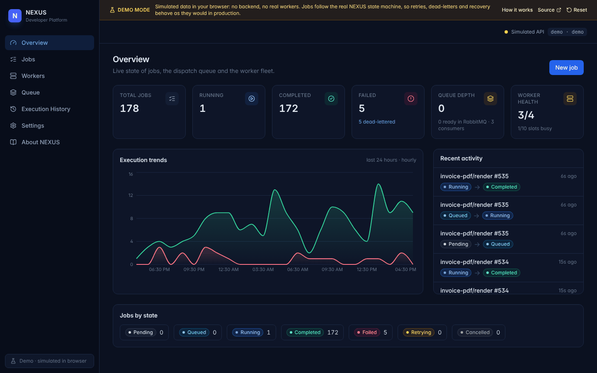
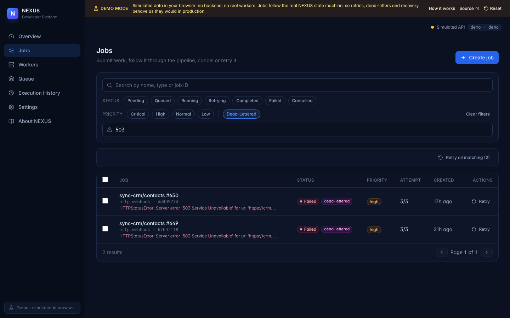
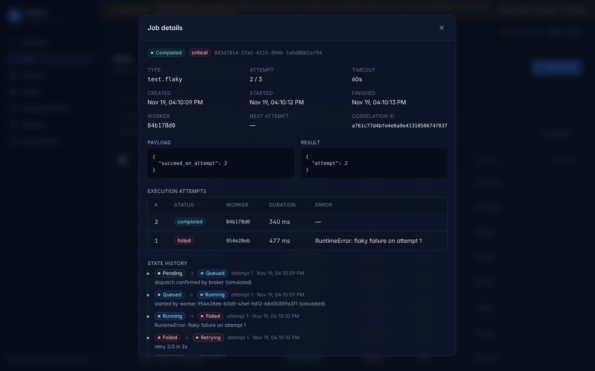
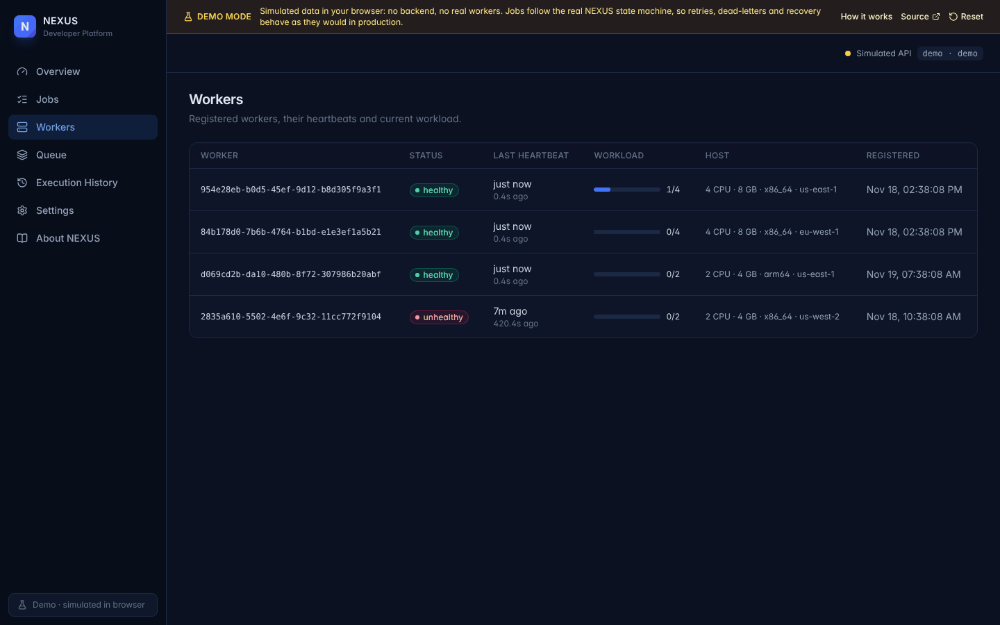

# NEXUS — Internal Developer Platform

NEXUS runs your platform's background jobs reliably and shows you exactly what happened to each one.

Submit a job from the dashboard or the API. NEXUS then:
- stores it in PostgreSQL;
- dispatches it through RabbitMQ, and only marks it queued once the broker confirms the message;
- runs it on a registered, heartbeating worker with a timeout;
- retries failures with exponential backoff;
- dead-letters what cannot succeed;
- records every attempt.

```
Dashboard (React) ──► API (FastAPI) ──► PostgreSQL ◄──────────────────────┐
                         │  jobs + outbox (one transaction)                │
                         ▼                                                 │
                   outbox relay ──publisher confirm──► RabbitMQ ──► Worker(s)
                         ▲                 nexus.jobs (priority)   register/heartbeat
                         │                 nexus.dead-letter       execute, report
                  Scheduler (leader-elected, fencing token):
                  relay retries · dead-worker detection · lease expiry
```

## Documentation

| Guide | For |
|---|---|
| [Local development](docs/LOCAL_DEVELOPMENT.md) | Starting, stopping, resetting, testing and debugging on your machine |
| [Learning guide](docs/LEARNING_GUIDE.md) | How NEXUS works, from the code: request and job lifecycles, outbox, inbox, retries, DLQ, scheduler, failure recovery, self-fencing |
| [Interview guide](docs/INTERVIEW_GUIDE.md) | Questions and answers grounded in the implementation, with limitations and trade-offs |
| [Roadmap](docs/ROADMAP.md) | Next engineering phases: reliability, fair scheduling, DAGs, observability, performance, security, DX |
| [Production deployment](docs/PRODUCTION_DEPLOYMENT.md) · [review](docs/FINAL_DEPLOYMENT_REVIEW.md) | Optional: running the real stack on a server (kept as a learning resource) |
| [GitHub Pages demo](docs/github-pages-demo.md) | The static, simulated dashboard demo |

## Live demo

> **Status: not deployed yet.** The [Pages workflow](.github/workflows/pages.yml) publishes the demo to `https://anshdwi.github.io/Nexus/` once GitHub Pages is enabled (**Settings → Pages → Source: GitHub Actions**) and the change is merged into `main`. This line will link to the live site after the first verified deployment.

The demo is the real dashboard built in **demo mode**. GitHub Pages can only serve static files, so it runs no API, broker, database or workers. The dashboard's API client talks to an in-browser simulator instead:
- The simulator answers the same endpoints, seeded with 24 hours of history.
- It moves jobs through the same state machine, retry backoff and dead-letter rules as the backend.
- A banner on every page says the data is simulated.

Everything else — real execution, RabbitMQ, persistence, monitoring — runs with `docker compose up --build`. See [docs/github-pages-demo.md](docs/github-pages-demo.md) for how the demo is built, deployed and isolated.

| Overview | Dead-letter recovery |
|---|---|
|  |  |
| **Job detail: automatic retry with backoff** | **Worker fleet, including an unhealthy worker** |
|  |  |

<sub>Screenshots are from the demo build, so the data is simulated.</sub>

## Features

- **Job API:** create (with idempotency keys), list, search, filter, cancel, retry, and bulk-retry, with tenant-scoped API keys and rate limiting.
- **Reliable dispatch:** a transactional outbox plus RabbitMQ publisher confirms. A job is QUEUED only once the broker has the message.
- **Worker fleet:**
  - registration, heartbeats and capacity-aware consumption;
  - timeouts;
  - graceful drain on SIGTERM;
  - dead-worker detection and recovery.
- **Retries and dead letters:**
  - exponential backoff;
  - permanent-error handling;
  - dead-lettering;
  - single and bulk retry filtered by error;
  - broker dead-letter pruning.
- **Scheduler:** leader election with fencing tokens, so a stale replica can never write.
- **Dashboard:** overview, jobs, workers, queue, execution history and settings, refreshed live.
- **Monitoring:** Prometheus metrics computed from durable state, 11 alert rules, and a provisioned Grafana dashboard.
- **Delivery:**
  - a one-command Docker Compose stack;
  - CI with unit, integration and end-to-end tests;
  - Vercel deployment;
  - the GitHub Pages demo.

## Tech stack

| Layer | Technology |
|---|---|
| Backend | Python 3.12, FastAPI, SQLAlchemy 2 (async), Alembic, Pydantic |
| Messaging and storage | RabbitMQ (aio-pika), PostgreSQL, Redis |
| Frontend | React 19, TypeScript, Vite, Tailwind CSS, TanStack Query, React Router, Recharts |
| Testing | pytest, Vitest, Testing Library, MSW |
| Operations | Docker Compose, Prometheus, Grafana, GitHub Actions, Vercel, GitHub Pages (demo) |

---

## Contents

1. [Quick start](#quick-start)
2. [Job lifecycle](#job-lifecycle)
3. [Architecture](#architecture) · [Reliability](#reliability-who-may-run-an-attempt-and-when)
4. [API reference](#api-reference)
5. [Configuration](#configuration)
6. [Monitoring](#monitoring)
7. [Testing](#testing)
8. [Production deployment](#production-deployment)
9. [Deploying to Vercel](#deploying-to-vercel)
10. [GitHub Pages demo](#github-pages-demo)
11. [Known limitations](#known-limitations)

---

## Quick start

### With Docker Compose (recommended)

Requires only Docker with Compose v2. Nothing else needs to be installed or running.

```bash
git clone https://github.com/AnshDwi/Nexus.git && cd Nexus
cp .env.example .env            # optional: local defaults; also turns on Prometheus + Grafana
docker compose up --build -d --wait
docker compose ps               # every service healthy; migrate "exited (0)"
```

Open the dashboard at http://localhost:5173 (API key `dev-key`). The API docs are at http://localhost:8000/api/docs. With `.env` copied, Grafana is at http://localhost:3000 and Prometheus at http://localhost:9090, because `.env.example` sets `COMPOSE_PROFILES=observability`.

`--wait` returns once every health check passes. That takes about 20 s with cached images, and longer on the first build.

| Service | What it is | Host address |
|---|---|---|
| `postgres` | PostgreSQL 16 (volume `postgres_data`) | 127.0.0.1:5432 |
| `rabbitmq` | RabbitMQ 3.13 + management UI (volume `rabbitmq_data`) | 127.0.0.1:5672, http://localhost:15672 (`nexus`/`nexus`) |
| `redis` | Shared rate-limit counters (volume `redis_data`) | 127.0.0.1:6379 |
| `migrate` | One-shot `alembic upgrade head`; everything below waits for it | — |
| `api` | FastAPI (`/api/v1/ready` health check) | http://localhost:8000/api/docs |
| `scheduler` | Outbox relay, retry dispatch, dead-worker and lease recovery | — |
| `worker` | RabbitMQ worker, capacity `WORKER_CAPACITY` (4) | — |
| `worker-small` | Second worker, capacity `WORKER_SMALL_CAPACITY` (2) | — |
| `dashboard` | Production build served by `vite preview`, proxying `/api` to `api` | http://localhost:5173 |

Startup order is enforced with health checks:
1. `postgres`, `rabbitmq` and `redis` become healthy.
2. `migrate` runs and exits 0.
3. `api`, `scheduler` and the workers start.
4. `dashboard` starts once `api` is healthy.

All ports bind to 127.0.0.1. Change any of them with `*_HOST_PORT` in `.env`.

**Walkthrough** (dashboard at http://localhost:5173, API key `dev-key`):

1. **Submit a job.** *Jobs → Create job*, type `echo`, payload `{"msg":"hi"}`.
2. **View its execution.** Open the job. Its timeline shows PENDING → QUEUED → RUNNING → COMPLETED, with the attempt, worker and duration. *Executions* lists every attempt.
3. **Trigger a failure and a retry.** Create a `test.flaky` job with payload `{"succeed_on_attempt": 3}` and *Max attempts* 2. It fails, waits out the backoff (RETRYING), fails again and is dead-lettered. Click **Retry** and it completes on attempt 3.
4. **View dead-lettered jobs.** Use the *Dead-lettered* chip on *Jobs*, or *Queue → View dead-lettered jobs*. Each failed row shows its last error. The broker side is the `nexus.dead-letter` queue in the RabbitMQ UI.
5. **Retry in bulk.** Narrow the list with *Last error contains…* (for example `timeout`). Then either tick rows and use **Retry selected**, or use **Retry all matching** (up to 100, after a confirmation).

The same flow with curl:

```bash
KEY="Authorization: Bearer dev-key"
JOB=$(curl -s -X POST localhost:8000/api/v1/jobs -H "$KEY" -H "Content-Type: application/json" \
  -d '{"name":"flaky","job_type":"test.flaky","payload":{"succeed_on_attempt":3},"max_attempts":2,"initial_backoff_seconds":1}' \
  | python3 -c 'import sys,json;print(json.load(sys.stdin)["job_id"])')
sleep 8; curl -s localhost:8000/api/v1/jobs/$JOB -H "$KEY"            # state failed, dead_lettered_at set
curl -s "localhost:8000/api/v1/jobs?dead_lettered=true" -H "$KEY"       # dead-letter list
curl -s -X POST localhost:8000/api/v1/jobs/$JOB/retry -H "$KEY"         # manual retry → completes on attempt 3
```

**Demo scenario (optional, opt-in).** This loads a repeatable scenario through the public API:
- one successful job;
- one retryable failure that recovers on attempt 2;
- one permanent failure that is not retried;
- one job that exhausts its retries and is dead-lettered;
- eight load jobs that occupy both workers.

```bash
docker compose --profile demo run --rm seed
```

Every number on the dashboard then comes from these real jobs, which really executed. Nothing is written to the database directly. The seed:
- refuses to run unless `ENVIRONMENT` is `local`, `test` or `development`;
- requires the `test.*` job types;
- names its jobs `demo-<run>/…`;
- checks every expected outcome and exits non-zero if any differs.

You can run it repeatedly; each run uses fresh idempotency keys.

**Stop and reset:**

```bash
docker compose --profile "*" down    # stop everything (incl. monitoring/demo); data is kept
scripts/reset-local.sh               # asks for confirmation, then deletes all local data
```

`--profile "*"` matters: a plain `docker compose down` skips services started under a profile (Prometheus, Grafana), which keep running.

[docs/LOCAL_DEVELOPMENT.md](docs/LOCAL_DEVELOPMENT.md) has every everyday command (logs, restarts, consoles, tests, hot-reload frontend, migrations) and troubleshooting.

`docker compose stop` sends SIGTERM. Workers drain: they stop consuming, let in-flight jobs finish within `WORKER_SHUTDOWN_GRACE_SECONDS`, hand unfinished attempts back as RETRYING and deregister. Each worker's `stop_grace_period` is longer than that grace.

**Base images.** The defaults are `python:3.12-slim`, `node:22-alpine`, `postgres:16-alpine`, `rabbitmq:3.13-management-alpine` and `redis:7-alpine`. To use a mirror, set `NEXUS_PYTHON_IMAGE`, `NEXUS_NODE_IMAGE`, `NEXUS_POSTGRES_IMAGE`, `NEXUS_RABBITMQ_IMAGE` or `NEXUS_REDIS_IMAGE`.

### Without Docker

Requires Python 3.12 + [uv](https://docs.astral.sh/uv/), Node 22, and PostgreSQL 16, RabbitMQ 3.12+ and Redis running locally.

```bash
uv sync && cp .env.example .env
uv run alembic upgrade head
uv run uvicorn vercel_app.api:app --reload                    # API on :8000
uv run python -m nexus.daemon scheduler                       # relay + recovery
DAEMON_HEALTH_PORT=8082 uv run python -m nexus.daemon worker  # RabbitMQ worker
cd frontend && npm ci && npm run dev                          # dashboard on :5173
uv run python -m nexus.demo seed --wait                       # optional demo scenario
```

---

## Job lifecycle

```
PENDING ──► QUEUED ──► RUNNING ──► COMPLETED
   │          ▲           │
   │          │           ▼
   │       RETRYING ◄── FAILED   (automatic while attempts remain;
   │                      │       manual "Retry" after a final failure)
   └──────────┴───────────┴────► CANCELLED
```

| Rule | Mechanism |
|---|---|
| The job row and its dispatch message are created atomically | Transactional outbox (same DB transaction as the job) |
| QUEUED only after the broker accepted the message | Relay publishes with **publisher confirms** and `mandatory` routing; QUEUED is written in the same transaction that observed the confirm |
| Retries are delayed | FAILED → RETRYING writes a dispatch held back until `next_attempt_at` (exponential backoff, capped) |
| Each delivery runs at most once | Inbox record per message (`job-executor:{message_id}`) + attempt check |
| Stale workers cannot change state | Results accepted only from the worker holding the live attempt (`attempt` + `worker_id` compare-and-set under the job's row lock) |
| Stale leaders cannot change state | Scheduler writes run under a `FOR SHARE` check of its lease **fencing token** |
| Dead workers' jobs are retried | Heartbeat TTL → scheduler fails and retries their RUNNING jobs, but only once the leader has watched heartbeats for a full TTL (**observation window**) |
| A cut-off worker stops before its job is retried elsewhere | **Self-fencing**: no successful heartbeat for 20 s → cancel handlers, stop consuming, hand attempts back; **fail-stop** exits the process if a handler won't stop |
| A finished result survives a database blip | **Report retry** until it commits, the database rejects it, or the attempt's lease deadline passes |
| Hung jobs are retried | Execution lease = timeout + grace; expiry → FAILED → RETRYING |
| Final failures are dead-lettered | Job FAILED with `dead_lettered_at`; message rejected to `nexus.dead-letter` when the worker reports the final failure |
| Graceful shutdown | SIGTERM: draining, stop consuming, keep heartbeating while in-flight work finishes (grace period), cancel unfinished handlers and report them `lost` (retried), deregister |

**Delivery guarantee.** Job *state* changes happen once per attempt. Job *handlers* run **at least once**: a worker that crashes after a side effect but before its result is recorded causes a re-run. NEXUS does not provide exactly-once external side effects; handlers receive a stable idempotency key (`TaskContext.idempotency_key`, the job ID, sent by `http.webhook` as `Idempotency-Key`) so receivers can deduplicate.

---

## Architecture

The code follows Clean Architecture: dependencies point inward, and the domain is pure and fully unit-tested.

```
src/nexus/
  domain/          job.py (Job aggregate + state machine), task_state, admission, leader_election…
  application/     ports (Protocols) + use cases: jobs.py (create, dispatch hook, claim,
                   report, cancel, retry, recover), relay_outbox_once, admission_controller…
  infrastructure/  db (models, repositories), messaging (RabbitMQ topology/publisher/worker,
                   Vercel Queues adapter), coordination (leader lease, worker registry),
                   execution (job executor, handlers, maintenance), observability
  api/             FastAPI routers (jobs, platform, tasks, health, internal), auth, rate limiting
  daemon.py        `scheduler` and `worker` processes
frontend/          React + TypeScript + Vite + Tailwind dashboard
vercel_app/        Vercel entrypoint shims (src/ layout)
migrations/        Alembic
```

Design records:
- [ADR 0001: Inbox](docs/adr/0001-exactly-once-inbox-pattern.md)
- [ADR 0002: Outbox](docs/adr/0002-transactional-outbox-pattern.md)
- [ADR 0003: Leader lease and fencing](docs/adr/0003-scheduler-leader-election.md)
- [ADR 0004: Vercel-first execution](docs/adr/0004-vercel-first-execution.md)
- [ADR 0005: Job pipeline over RabbitMQ](docs/adr/0005-job-pipeline-rabbitmq.md)

### Reliability: who may run an attempt, and when

Two processes can disagree about whether a worker is alive: the scheduler, which sees only heartbeat rows in PostgreSQL, and the worker, which knows its handlers are running. Four mechanisms keep them from both acting on the same attempt. The database stays the final authority throughout: every result is a compare-and-set on `(state RUNNING, attempt, worker_id)` under the job's row lock (`_live_attempt` in `application/use_cases/jobs.py`).

**Scheduler observation window** (`infrastructure/coordination/observation_window.py`). A worker is declared dead when its heartbeat is older than `WORKER_HEARTBEAT_TTL_SECONDS`, but that only proves something if heartbeats *could* have been written and read meanwhile. After a PostgreSQL outage every heartbeat looks stale. So the leader skips the dead-worker sweep until it has itself had uninterrupted database access, as the leader, for a full TTL. The window restarts after a failed maintenance pass, when the replica is not (or no longer) the leader, when it (re)acquires leadership (including renewing its own lapsed lease), and when two passes are further apart than the leader lease. Lease-expiry recovery, redispatch, task reconciliation and the relay are never delayed. The stateless cron endpoint passes no window and sweeps as before.

**Worker execution authority and sticky epochs** (`infrastructure/coordination/execution_authority.py`). Each worker computes its own deadline: *start of its last successful heartbeat + `fence_after`* (20 s by default, always less than TTL − heartbeat interval). Because the start time is taken before the heartbeat statement and the database stamps `last_heartbeat_at` later, the worker's deadline always falls before the scheduler could declare it dead; no clock synchronisation is needed. Every claim is stamped with the worker's current **epoch**. Fencing increments the epoch, and attempts from an older epoch never regain authority, even if a later heartbeat succeeds (**sticky fencing**). A heartbeat that only succeeds after the deadline fences first.

**Self-fencing** (`infrastructure/messaging/rabbitmq_worker.py`, `infrastructure/execution/job_executor.py`). When the deadline passes, or a heartbeat finds the worker deregistered, the worker:
1. cancels the handlers of attempts from the old epoch (only the handler; a report in progress is never cancelled);
2. stops consuming (prefetched messages return to the queue) and reports unhealthy;
3. claims nothing new: no claim is attempted without authority, and an attempt whose authority was lost while its claim was in flight never starts;
4. **hands the attempts back** as soon as PostgreSQL accepts it: recorded as `lost` and retried per the job's policy. It is a compare-and-set too, so a no-op if the scheduler already recovered the job;
5. resumes consuming after its next successful heartbeat, under a new epoch.

An outcome is reported only if its handler finished while the attempt still had authority. Results produced in time are still recorded after a delay: the compare-and-set alone decides whether they are wanted. Handlers can call `TaskContext.check_authority()` right before a side effect; `http.webhook` does so before its POST. A redelivered message whose claim had committed although the worker saw an error (a **stranded claim**: RUNNING under this worker, no handler) is handed back too.

**Fail-stop watchdog** (`infrastructure/coordination/fail_stop.py`). Cancellation only stops handlers that yield to the event loop. A thread (so a blocked event loop cannot stop it) exits the process with code 70 if any handler is still alive TTL − interval (25 s) after the last good heartbeat. Docker restarts the worker, messages return to the queue, and the scheduler recovers the jobs. It is inert before the first heartbeat and stopped before heartbeats stop at shutdown. On by default in the daemon (`WORKER_FAIL_STOP`).

**Report retry (C2)** (`JobExecutor._report`). Recording an outcome is retried with backoff (0.5 s doubling to 5 s) until it commits, the database rejects it (fenced), or the attempt's lease deadline (claim start + timeout + grace) passes. Retrying is safe because every report is a compare-and-set. A commit whose reply was lost is read back, so a recorded result is not mistaken for a fenced one.

**Failure recovery lifecycle** (defaults: heartbeat 5 s, TTL 30 s, `fence_after` 20 s, fail-stop 25 s):

| Situation | Worker | Scheduler | Outcome |
|---|---|---|---|
| Worker crashes | Gone | After TTL (once its window is open): attempt `lost`, retry dispatched | Retried elsewhere |
| Worker cut off from PostgreSQL, others fine | At 20 s: cancels handlers, stops consuming | At 30 s: declares it dead, retries the job | Attempts run one after another, never at the same time |
| Everyone loses PostgreSQL > 20 s | Fences, cancels handlers; hands back when PostgreSQL returns | Waits a full TTL of observation before sweeping | Interrupted attempts retried; no false "dead" verdicts |
| PostgreSQL blip < 20 s | Nothing; a pending report retries until it commits | Nothing | No retry, no re-run |
| Handler ignores cancellation / blocks the loop | Fail-stop exits at 25 s | Recovers after TTL | Retried elsewhere |
| Worker deregistered while running | Fences immediately, hands back, re-registers | — | Retried |
| Graceful shutdown | Drains (heartbeating), then cancels handlers, reports `lost` | — | Retried |

Interrupted attempts count against `max_attempts` (see H-1 under [Known limitations](#known-limitations)).

### How the scheduler works

`python -m nexus.daemon scheduler` runs a loop. Any number of replicas may run; one at a time holds the leader lease, a PostgreSQL row with a monotonically increasing **fencing token**. Every write the leader makes re-checks its token under `SELECT … FOR SHARE`, so a paused, deposed leader cannot commit. Each pass the leader:

1. **Relays the outbox.** It publishes due dispatch messages (`available_at <= now()`) to the `nexus.jobs` exchange with publisher confirms. A message only marks its job QUEUED after the broker confirms it. Unroutable or nacked messages stay in the outbox and are retried.
2. **Detects dead workers.** Once its observation window spans a full TTL (see above), it treats workers whose heartbeat is older than `WORKER_HEARTBEAT_TTL_SECONDS` as dead. Their RUNNING jobs are failed (`lost`) and retried.
3. **Expires leases.** It fails a RUNNING attempt whose execution lease (timeout + grace) has expired, which retries it or dead-letters it.
4. **Prunes resolved dead letters.** It removes `nexus.dead-letter` messages whose job is no longer dead-lettered for that attempt, because the job was retried. Messages for jobs still dead-lettered, task messages and unparseable (poison) messages are kept. Each job's full history stays in the database. The broker holds a message only for final failures a worker reported; jobs dead-lettered by scheduler recovery (dead worker, expired lease, hand-back on the last attempt) have none, so the broker count can be lower than the dashboard's. Turn this off with `DEAD_LETTER_PRUNE_RESOLVED=false`.

On Vercel, steps 1–3 also run from the `/internal/maintenance` cron as a backstop, and `POST /internal/dead-letter/prune` does step 4 on demand.

### How workers execute jobs

`python -m nexus.daemon worker`:

1. **Registers.** Records id, hostname and capacity, and heartbeats on database time. Each successful heartbeat extends its execution authority.
2. **Consumes.** Takes from `nexus.jobs` with `prefetch = capacity`, while it has authority.
3. **Claims each delivery** in one transaction:
   - records an inbox entry (`job-executor:{message_id}`), so a redelivery is a no-op;
   - checks that the message's attempt is the job's current one;
   - moves the job QUEUED → RUNNING, with an execution row and lease.
4. **Runs the handler** in its own task with the job's timeout.
5. **Reports** COMPLETED or FAILED, retrying through database blips, fenced on `attempt` + `worker_id`, so a result from a worker that lost the job is discarded. If the worker fenced before the handler finished, it hands the attempt back instead.

On failure:
- **Retryable:** the job moves FAILED → RETRYING and a new dispatch is written to the outbox, held back until `next_attempt_at`. The backoff is `initial_backoff_seconds · 2^(attempt-1)`, capped at `max_backoff_seconds`.
- **Permanent, or the last attempt:** the job stays FAILED with `dead_lettered_at` set, and the message is rejected into `nexus.dead-letter`.

`POST /jobs/{id}/retry` gives a FAILED job a fresh attempt budget.

**Job types.** Workers only run registered handlers, never code supplied in a request:

| Type | What it does |
|---|---|
| `echo` | Returns its payload |
| `http.webhook` | POSTs to hosts in `WEBHOOK_ALLOWED_HOSTS` |
| `test.sleep`, `test.flaky`, `test.fail` | Only when `TASK_ENABLE_TEST_HANDLERS=true` |

Add a type in `infrastructure/execution/handlers.py`.

**Tasks API.** The earlier `/api/v1/tasks` DAG pipeline (dependencies, `not_before`, Vercel Queues push consumer) is unchanged and is also executed by the RabbitMQ worker (`nexus.tasks` queue).

---

## API reference

Everything is under `/api/v1`. Authenticate with `Authorization: Bearer <api key>`.

- **Keys are tenant-scoped.** Another tenant's job returns 404.
- **Errors** look like `{"detail": {"code", "message", "details?"}}`. Internals are never exposed, and 500s carry a `request_id`.
- **Every response** carries `X-Request-ID` and `X-Correlation-ID`. Send `X-Correlation-ID` to trace a job across API, relay and worker logs.
- **Interactive docs:** `/api/docs`.

| Method | Path | Description |
|---|---|---|
| `POST` | `/jobs` | Create. Body: `name`, `job_type`, `payload`, `priority` (`low\|normal\|high\|critical`), `max_attempts` (1–20), `timeout_seconds`, `initial_backoff_seconds`, `max_backoff_seconds`. `Idempotency-Key` header: replays return the original job (200). 201 created · 422 invalid/rejected · 413 payload too large · 429 rate limited |
| `GET` | `/jobs` | List with pagination: `page`, `page_size` (≤100), `status` (repeatable), `priority` (repeatable), `q` (name/type/ID search), `dead_lettered=true` (only dead-lettered jobs), `error` (case-insensitive substring of the last error) |
| `GET` | `/jobs/{id}` | Job, state transitions and execution attempts |
| `POST` | `/jobs/{id}/cancel` | Cancel PENDING/QUEUED/RETRYING/RUNNING (409 otherwise). A running attempt's result is discarded |
| `POST` | `/jobs/{id}/retry` | Retry a FAILED job with a fresh attempt budget (409 otherwise) |
| `POST` | `/jobs/bulk-retry` | Retry up to 100 FAILED jobs in one transaction. Body: `{"job_ids": [...]}`, or `{"dead_lettered": true, "error": "...", "q": "...", "limit": 100}` to select dead-lettered jobs by filter. Returns `retried` and `skipped` (with `not_found` / `not_retryable` per job); a skipped job does not undo the others |
| `GET` | `/workers` | Registered workers: status (healthy/unhealthy/draining), heartbeat age, running jobs vs capacity |
| `GET` | `/queue` | Pending/queued/retrying jobs by priority with dispatch status; `dead_lettered_jobs` (database) and broker ready/dead-letter message counts |
| `GET` | `/executions` | Execution history: `status`, `job_id`, `page`, `page_size` |
| `GET` | `/metrics/summary` | Overview: totals by state, queue depth, worker health, recent activity, hourly trend |
| `GET` | `/system` | Dependency checks, job types, non-secret configuration |
| `GET` | `/health` · `/ready` | Liveness · readiness (503 when a configured dependency fails) |
| `GET` | `/internal/maintenance` | Scheduler pass (`Bearer $CRON_SECRET`) |
| `GET` | `/internal/metrics` | Prometheus (`Bearer $METRICS_TOKEN`): process counters plus fleet-wide figures from the database and broker (see [Monitoring](#monitoring)) |
| `POST` | `/internal/dead-letter/prune` | Prune resolved `nexus.dead-letter` messages now (`Bearer $CRON_SECRET`) |
| | `/tasks…` | DAG task API (see ADR 0004) |

---

## Configuration

All configuration comes from environment variables (see `.env.example`). Outside `local`/`test`, the API **refuses to start** if any of these hold:
- database or RabbitMQ credentials are the built-in defaults;
- `API_KEYS` is empty;
- `DEBUG` is on;
- CORS origins are `*` or not https.

| Variable | Purpose |
|---|---|
| `DATABASE_URL` / `DATABASE_URL_UNPOOLED` | Postgres (provider URLs accepted; `sslmode` handled; PgBouncer auto-detected). Discrete `POSTGRES_*` also supported |
| `DB_POOL_SIZE`, `DB_MAX_OVERFLOW`, `DB_POOL_MODE` | Pooling: small per-instance pool (`queue`, Fluid-compute safe) or `null` behind an external pooler |
| `RABBITMQ_URL` | Broker (`amqps://…` for managed brokers). `EVENT_BUS=rabbitmq` (default) \| `vercel_queues` \| `none` |
| `REDIS_URL` | Shared rate-limit counters (optional; falls back to per-process) |
| `API_KEYS` | `tenant:sha256(key),…`. Generate with `uv run python -m nexus.cli new-api-key <tenant>` |
| `CORS_ALLOWED_ORIGINS` | Dashboard origin(s) when served from another domain |
| `RATE_LIMIT_READS_PER_MINUTE`, `RATE_LIMIT_WRITES_PER_MINUTE` | Per tenant |
| `WORKER_CAPACITY` | Concurrent jobs per worker (default 4) |
| `WORKER_HEARTBEAT_INTERVAL_SECONDS`, `WORKER_HEARTBEAT_TTL_SECONDS` | Heartbeat every 5 s; a worker silent for 30 s is dead (scheduler) |
| `WORKER_SELF_FENCE_AFTER_SECONDS` | Worker stops executing this long after its last good heartbeat. Unset: TTL − max(2 × interval, 20% of TTL) = 20 s. Must be ≥ 2 × interval and < TTL − interval, or the worker refuses to start |
| `WORKER_FAIL_STOP` | Exit the worker (code 70) if a handler is still alive TTL − interval (25 s) after the last good heartbeat (default `true`) |
| `WORKER_SHUTDOWN_GRACE_SECONDS` | Graceful drain on SIGTERM (default 25 s; then up to 5 s more for reports) |
| `WORKER_FORGET_AFTER_TTLS` | Deregister workers silent for this many TTLs (default 20) |
| `SCHEDULER_LEASE_DURATION_SECONDS`, `DAEMON_TICK_INTERVAL_SECONDS` | Leader lease 15 s; maintenance pass every 5 s |
| `TASK_LEASE_GRACE_SECONDS` | Execution lease = timeout + this grace (default 30 s) |
| `JOB_REDISPATCH_AFTER_SECONDS` | Re-dispatch a job whose dispatch message seems lost (default 900 s) |
| `JOB_DEFAULT_TIMEOUT_SECONDS`, `JOB_MAX_TIMEOUT_SECONDS`, `JOB_DEFAULT_MAX_ATTEMPTS` | Job limits (60 s, 3600 s, 3) |
| `CRON_SECRET`, `METRICS_TOKEN` | Protect internal endpoints (compose default for `METRICS_TOKEN`: `local-metrics-token`) |
| `DEAD_LETTER_PRUNE_RESOLVED`, `DEAD_LETTER_PRUNE_BATCH` | Scheduler pruning of resolved broker dead letters (default on, 200 per pass) |
| `TASK_ENABLE_TEST_HANDLERS` | Registers `test.sleep`/`test.flaky`/`test.fail` (local and CI only) |
| `WORKER_SMALL_CAPACITY` | Compose only: capacity of the second worker |
| `*_HOST_PORT` | Compose only: host ports (`API_`, `DASHBOARD_`, `POSTGRES_`, `RABBITMQ_`, `RABBITMQ_MANAGEMENT_`, `REDIS_`) |
| `NEXUS_*_IMAGE` | Compose only: base-image overrides (mirrors), including `NEXUS_PROMETHEUS_IMAGE` and `NEXUS_GRAFANA_IMAGE` |
| `PROMETHEUS_HOST_PORT`, `GRAFANA_HOST_PORT`, `PROMETHEUS_RETENTION`, `GRAFANA_ADMIN_PASSWORD` | Compose `observability` profile |
| `DEMO_API_KEY` | Compose only: key used by the `seed` service (default `dev-key`) |

Logs are JSON lines carrying `request_id`, `correlation_id`, `job_id` and `attempt`.

---

## Monitoring

```bash
docker compose --profile observability up -d   # already included if you copied .env.example
```

- **Prometheus** at http://localhost:9090, with the alert rules loaded.
- **Grafana** at http://localhost:3000. The *NEXUS — Job platform* dashboard is provisioned and opens as the home page. Viewing is anonymous; sign in as `admin` with `GRAFANA_ADMIN_PASSWORD` to edit.

**Where the numbers come from.** The API's `/internal/metrics` serves two kinds of data:
- its own process counters;
- fleet-wide figures read from PostgreSQL and RabbitMQ at scrape time.

Because the fleet-wide figures come from durable state, they are complete and identical whichever API instance answers, and survive restarts. That includes Vercel Functions, where in-memory counters reset per instance. Each daemon serves its own counters on its private health port (`:8081/metrics`).

| Metric | Meaning |
|---|---|
| `nexus_jobs{tenant,state}` | Jobs in each state |
| `nexus_jobs_dead_lettered{tenant}` | Jobs currently dead-lettered |
| `nexus_jobs_oldest_waiting_seconds` | Age of the oldest PENDING/QUEUED job |
| `nexus_job_executions_total{job_type,status}` | Attempts recorded (counter; use `rate()`) |
| `nexus_job_execution_duration_seconds_{sum,count}{job_type}` | Attempt durations (average = rate(sum) / rate(count)) |
| `nexus_outbox_due`, `nexus_outbox_lag_seconds`, `nexus_outbox_failed_permanently` | Dispatches not yet confirmed by the broker |
| `nexus_workers{status}`, `nexus_worker_capacity_slots`, `nexus_worker_busy_slots` | Worker fleet |
| `nexus_broker_up`, `nexus_broker_ready_messages`, `nexus_broker_consumers`, `nexus_broker_dead_letter_messages` | RabbitMQ |
| `nexus_state_database_up` | Whether the state above could be read |

Reliability counters, served by each daemon on `:8081/metrics`:

| Metric | Meaning |
|---|---|
| `scheduler_dead_worker_sweeps_deferred_total` | Leader passes that skipped the dead-worker sweep (observation window not yet a full TTL) |
| `nexus_worker_self_fences_total{reason}` | Times a worker fenced itself (`deadline` or `deregistered`) |
| `nexus_worker_handbacks_total{result}` | Attempts handed back (`recorded`, or `already_recovered` by the scheduler) |

**Alerts** (`deploy/observability/prometheus/alerts.yml`, unit-tested in `alerts.test.yml`):

| Severity | Alerts |
|---|---|
| Critical | `NexusApiDown`, `NexusDatabaseUnreadable`, `NexusBrokerDown`, `NexusNoHealthyWorkers` |
| Warning | `NexusUnhealthyWorkers`, `NexusOutboxLag`, `NexusOutboxFailedPermanently`, `NexusQueueBacklog`, `NexusJobsDeadLettered`, `NexusHighFailureRate` |
| Info | `NexusCapacitySaturated` |

Compose ships no Alertmanager. Point Prometheus at yours (`alerting:` in `prometheus.yml`), or import the rules into Grafana alerting.

**Production on Vercel.** Have a managed Prometheus (for example Grafana Cloud) scrape `https://<api-domain>/api/v1/internal/metrics` with `Bearer $METRICS_TOKEN`. Scrape one URL only: the fleet figures are already global. Then import `deploy/observability/grafana/dashboards/nexus.json` and the alert rules.

---

## Testing

```bash
# Backend
uv run ruff check . && uv run ruff format --check . && uv run mypy src
uv run pytest                                        # unit tests
uv run alembic upgrade head && uv run pytest -m integration   # needs Postgres, RabbitMQ, Redis

# Frontend
cd frontend && npm ci && npm run typecheck && npm run lint && npm test && npm run build
npm run test:demo      # demo simulator + the whole app as served under /Nexus/
npm run build:pages    # GitHub Pages build, verified by scripts/check-pages-build.mjs

# Migrations: upgrade, model/migration drift check, full downgrade
uv run alembic upgrade head && uv run alembic check && uv run alembic downgrade base

# Alert rules (needs promtool, or run it from the prom/prometheus image)
promtool check rules deploy/observability/prometheus/alerts.yml
cd deploy/observability/prometheus && promtool test rules alerts.test.yml

# Whole stack, end to end against the running containers
docker compose config --quiet
docker compose up --build -d --wait
uv run pytest -m e2e                                  # 8 lifecycle tests over HTTP
docker compose --profile demo run --rm seed           # scenario + outcome verification
docker compose down -v
```

The `e2e` suite (`tests/e2e/test_compose_stack.py`) uses only the public API and the dashboard. Point it elsewhere with `NEXUS_E2E_API_URL`, `NEXUS_E2E_DASHBOARD_URL` and `NEXUS_E2E_API_KEY`. It checks:
- dependency readiness;
- both workers and their capacities;
- the dashboard's SPA fallback and API proxy;
- full lifecycle transitions;
- flaky-job retry;
- exhaustion → dead-letter (database and broker) → manual retry;
- a permanent failure making only one attempt;
- summary counts that match the listing endpoints.

Outage drills (opt-in, a few minutes; never stop a container: an in-process TCP gate cuts PostgreSQL off from the workers or scheduler under test, using the isolated `nexus_test` database):

```bash
NEXUS_C1_REPRO=1 scripts/test-integration.sh tests/integration/test_c1_postgres_outage_overlap.py -v -s -rs
NEXUS_C1_REPRO=1 scripts/test-integration.sh tests/integration/test_worker_self_fencing_drills.py -v -s -rs
NEXUS_C1_REPRO=1 NEXUS_C1_TIMINGS=real scripts/test-integration.sh \
  tests/integration/test_c1_postgres_outage_overlap.py -k scheduler_reconnects_first -v -s -rs
```

Each prints its evidence (handler run times, executions, transitions) and fails if two attempts of the same job overlap.

What the suites cover:
- **Integration tests** run against real PostgreSQL, RabbitMQ and Redis:
  - job lifecycle and retries;
  - dead-lettering and manual retry;
  - timeouts and idempotency;
  - unroutable publishes never being marked QUEUED;
  - dead-worker recovery and fencing of stale workers and leaders;
  - the scheduler observation window and worker self-fencing (deregistration, pausing, hand-back, stranded claims, shutdown during a report, fail-stop);
  - report retry through database blips and ambiguous commits;
  - graceful shutdown and the poison-message DLQ;
  - tenant isolation and rate limiting (in-process and Redis);
  - the outbox, inbox and leader election.
- **Frontend tests:** components and pages, plus API integration through an MSW-mocked NEXUS API.

CI (`.github/workflows/ci.yml`) runs all of the above, plus offline `vercel build`s of both projects. On `main` it then migrates the production database, deploys, and verifies the deployment end to end.

---

## Production deployment

The recommended production setup runs the whole real stack on one server, using [`compose.production.yml`](compose.production.yml):
- Caddy with automatic HTTPS;
- the API, scheduler and scaled workers;
- PostgreSQL, RabbitMQ and Redis;
- Prometheus and Grafana.

A 2 vCPU / 4 GB VPS is enough: the stack idles at about 0.5 GB of RAM.

```bash
deploy/production/nexus.sh init nexus.example.com you@example.com   # .env.production with random secrets
deploy/production/nexus.sh deploy                                   # backup, build, migrate, start, verify
```

[docs/PRODUCTION_DEPLOYMENT.md](docs/PRODUCTION_DEPLOYMENT.md) is a beginner-level guide. It covers:
- a hosting comparison with costs;
- server setup;
- secrets;
- migrations;
- health checks;
- backups and rollback;
- troubleshooting;
- the readiness checklist.

The failure drills in `tests/e2e/test_production_resilience.py` (`-m resilience`) restart and kill real containers mid-job and verify that every job still finishes, with exactly one completed execution recorded. (Handlers can still run more than once; see the delivery guarantee under [Job lifecycle](#job-lifecycle).)

## Deploying to Vercel

See **[docs/vercel-deployment.md](docs/vercel-deployment.md)**. In short:

| Component | Where it runs |
|---|---|
| Dashboard | Vercel project with Root Directory `frontend/` (Vite static build, SPA routing, security headers) |
| API | Vercel project at the repo root (Python Function, `vercel_app.api:app`) |
| Scheduler + RabbitMQ workers | **Vercel Daemons** (`deploy/vercel.daemons.json`; public beta, production deployments only) |
| PostgreSQL | Managed (e.g. Neon via the Vercel Marketplace) |
| Redis | Managed (e.g. Upstash via the Marketplace), optional |
| RabbitMQ | **External managed AMQP broker** (Vercel does not host RabbitMQ), e.g. CloudAMQP or Amazon MQ, over `amqps://` |

---

## GitHub Pages demo

`.github/workflows/pages.yml` builds the dashboard in demo mode and publishes it to GitHub Pages.
- **Pull requests:** build and verify only.
- **Pushes to `main`:** build, deploy, then smoke-test the public URL.

It needs one setting: **Settings → Pages → Source: GitHub Actions**. Setup, the base-path configuration, the demo architecture, and what does and doesn't work without a backend are covered in [docs/github-pages-demo.md](docs/github-pages-demo.md).

---

## Known limitations

- **At-least-once handlers.** Self-fencing prevents two attempts of a job from running *at the same time*, not one after the other: a crash after a side effect but before the result is recorded re-runs the handler. Use the idempotency key for external side effects.
- **H-1: infrastructure failures consume the retry budget.** Shutdown, crash recovery, self-fencing hand-backs, stranded claims and lease expiry are all recorded as failed attempts. A `max_attempts=1` job interrupted by a deploy or a PostgreSQL outage longer than 20 s is dead-lettered although its handler never failed. See [docs/ROADMAP.md](docs/ROADMAP.md).
- **Self-fencing covers the RabbitMQ worker daemon only.** Not covered:
  - the **Vercel job path** (`EVENT_BUS=vercel_queues`): Functions do not heartbeat, so only lease expiry protects it;
  - the **tasks DAG pipeline** (`/tasks`, `TaskExecutor`): unchanged, attempt-guarded, no self-fencing or report retry;
  - the **cron maintenance endpoint** (`/internal/maintenance`): stateless, so it has no observation window and sweeps dead workers immediately.
- **A PostgreSQL outage longer than 20 s interrupts running jobs.** A worker cannot tell "everyone lost the database" from "only I did", so it stops and the attempts are retried.
- **Vercel Daemons are in public beta** and run only on production deployments. Preview deployments have an API but no scheduler or workers. The `/internal/maintenance` cron relays the outbox, but cannot execute jobs.
- **Vercel hosts no RabbitMQ.** A managed AMQP broker (for example CloudAMQP) is required in production.
- **Broker dead letters are not replayed.** Messages in `nexus.dead-letter` are evidence, not a work queue. Retrying a job writes a new dispatch, and the scheduler then prunes the old message. Until the next scheduler pass (every few seconds), the broker count can briefly exceed the dashboard's. Without the scheduler daemon (for example on Vercel preview deployments), call `POST /internal/dead-letter/prune`.
- **Scrape cost grows with history.** `/internal/metrics` runs aggregate queries over `jobs` and `job_executions` on every scrape. That's fine at a 15-second interval for typical volumes; with millions of execution rows, raise the interval or add retention.
- **Bulk retry is capped at 100 jobs per request.** For larger backlogs, repeat **Retry all matching**; each run takes the next 100.
- **Rate limiting without Redis is per process.** Set `REDIS_URL` for limits shared across instances.
- **Tasks API retries over RabbitMQ.** The legacy `/tasks` DAG API retries through the scheduler's reconciler rather than outbox hold-back, so its retry delay is rounded up to the scheduler interval.
- **Fixed job types.** Workers run only registered handlers (`echo`, `http.webhook`, test types). Arbitrary code is never accepted.
- **The GitHub Pages demo is a simulation.** It has no backend, so no job really executes there, and its data lives in browser memory and resets on reload. Its job outcomes are decided by the simulator; it follows the backend's state machine, but it isn't a test of the backend.
- **No per-user identity.** Authentication is API-key per tenant; there are no user accounts or roles.
