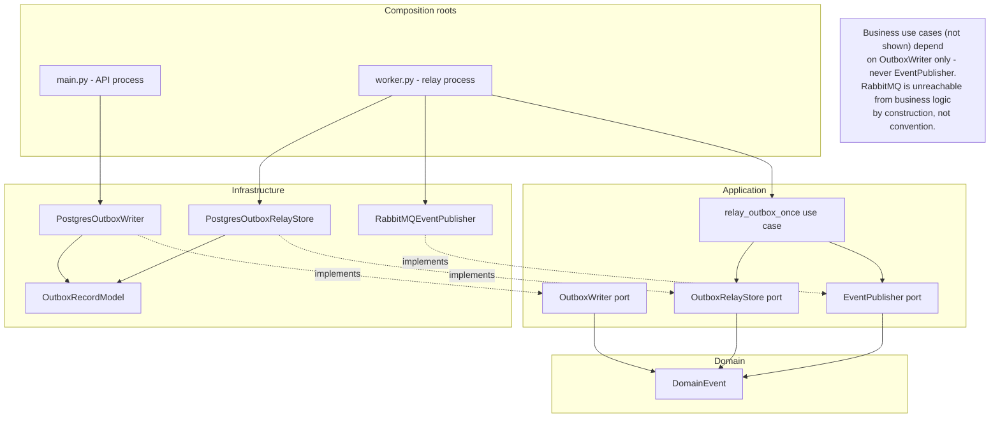
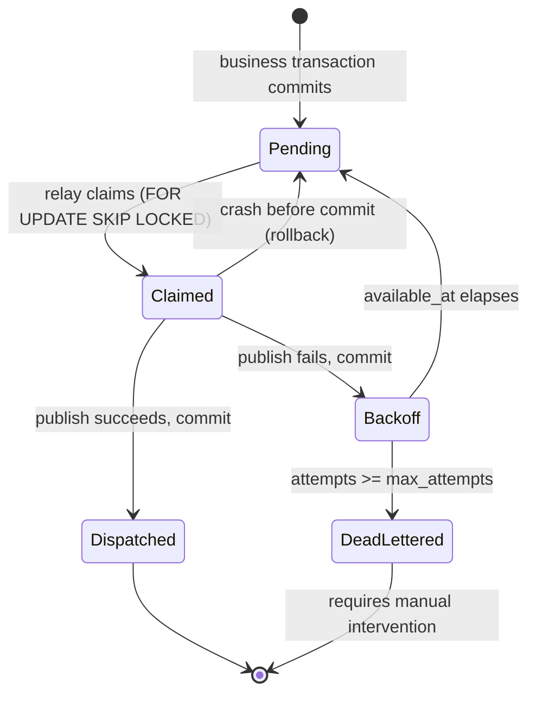

# Transactional Outbox Pattern

Full design documentation for Milestone 2 of the Exactly-Once Event Kernel.
Decisions with genuine alternatives are recorded in
[ADR 0002](../adr/0002-transactional-outbox-pattern.md); this document
covers the complete design, lifecycle, and guarantees.

## 1. Event lifecycle

1. A business use case constructs a `DomainEvent` and calls
   `OutboxWriter.add(event)` — a plain `INSERT` into `outbox_records`,
   participating in whatever transaction the caller's session is already in.
2. The caller commits. Business state and the outbox row become durable
   together, atomically, via native Postgres ACID guarantees. If the
   transaction never commits, neither exists — this is where the pattern's
   entire guarantee begins.
3. The relay (a separate `worker` process, possibly several replicas) polls
   in a loop. Each tick: claim the oldest eligible row with
   `SELECT ... FOR UPDATE SKIP LOCKED LIMIT 1`, attempt to publish it to
   RabbitMQ, then record the outcome — all in one transaction.
4. On publish success: `dispatched_at` is set, transaction commits.
5. On publish failure: `attempts` increments and `available_at` is pushed
   into the future using exponential backoff, transaction commits. After
   `outbox_relay_max_attempts`, the row is marked `failed_permanently_at`
   and stops being claimed.
6. RabbitMQ delivers the message (at-least-once) to a consumer bound to the
   `nexus.events` topic exchange.
7. The consumer applies its Inbox pattern (ADR 0001): insert the event's
   `event_id` into `inbox_records` in the same transaction as its side
   effect. A conflict means "already handled" — skip.

## 2. Sequence diagram

```mermaid
sequenceDiagram
    participant Client
    participant API as API (business use case)
    participant PG as PostgreSQL
    participant Relay as Outbox Relay (worker)
    participant MQ as RabbitMQ
    participant Consumer

    Client->>API: business operation
    API->>PG: BEGIN
    API->>PG: INSERT business row
    API->>PG: INSERT outbox row (OutboxWriter.add)
    API->>PG: COMMIT
    API-->>Client: response

    loop poll
        Relay->>PG: BEGIN; SELECT ... FOR UPDATE SKIP LOCKED
        PG-->>Relay: claimed row (or none)
        Relay->>MQ: publish(event)
        alt publish succeeds
            Relay->>PG: UPDATE dispatched_at; COMMIT
        else publish fails
            Relay->>PG: UPDATE attempts, available_at (backoff); COMMIT
        end
    end

    MQ->>Consumer: deliver message (at-least-once)
    Consumer->>PG: BEGIN
    Consumer->>PG: INSERT INTO inbox_records ON CONFLICT DO NOTHING
    alt new key
        Consumer->>PG: apply side effect
        Consumer->>PG: COMMIT
        Consumer->>MQ: ack
    else duplicate key
        Consumer->>PG: COMMIT (no-op)
        Consumer->>MQ: ack
    end
```

## 3. Component diagram

Dependency direction always points inward, toward the domain — the
Dependency Inversion half of Clean Architecture. Infrastructure depends on
Application's ports; Application never depends on Infrastructure.



## 4. Failure recovery

Outbox row state, derived from timestamps rather than a separate status
column:



The critical property: **every arrow back to `Pending` is a full transaction
rollback**, not a partial state. There is no reachable state where a row is
"half-claimed" or "maybe-dispatched" — it is always exactly one of these
states as far as Postgres is concerned, even though the relay process itself
may be uncertain (from its own perspective) whether RabbitMQ received a
message before it crashed. See §5 for what this uncertainty means in
practice.

| Scenario | Outcome |
|---|---|
| Crash before DB commit | Nothing happened. Native ACID atomicity. |
| Crash after commit, before relay polls | Row sits `Pending`; next poll (any replica) picks it up. Bounded delay = poll interval. |
| Crash during publish | Claim transaction never commits → reverts to `Pending` → retried. May cause a genuine duplicate if RabbitMQ *did* receive it before the crash — this is why consumers must be idempotent. |
| Crash after publish, before commit | Same as above — duplicate publish, deduped at the consumer via ADR 0001. Proven by `test_crash_between_publish_and_commit_leaves_event_retryable`. |
| Duplicate relay execution | `FOR UPDATE SKIP LOCKED` prevents two replicas from claiming the same row at the same instant. Proven by `test_claim_next_is_race_safe_under_concurrency` (10-way race, exactly one winner). |
| Concurrent relay workers | Same mechanism — this is what makes horizontal scaling of the relay safe, not just tolerated. |
| RabbitMQ unavailable | Publish fails; failure recorded with exponential backoff, no business-transaction impact. Dead-lettered after `max_attempts`. |
| PostgreSQL unavailable | Claim query fails; caught at the worker loop level, logged, backed off before the next attempt. Business writes are equally blocked — shared fate, since Postgres is the system of record for everything here. |

## 5. Engineering discussion

**Why true end-to-end exactly-once delivery is impossible.** Every hop where
two systems must coordinate over a network is an instance of the two
generals problem: the sender can never be certain the receiver got a message
before a crash or partition, and no acknowledgment scheme removes this
uncertainty — it only lowers how often it's exercised. The only safe
behavior under that uncertainty is to retry, which means duplicates are
structurally possible at every such hop (relay → broker, broker →
consumer). Any system claiming true exactly-once delivery is either
describing a narrower guarantee than it sounds like, or wrong.

**What this implementation actually guarantees:**

1. Atomicity between business state and event existence — unconditional,
   from Postgres ACID, not probabilistic.
2. At-least-once delivery of every *committed* event to the broker,
   eventually — conditional on the relay continuing to run and RabbitMQ
   eventually being reachable.
3. Exactly-once *effect application* at the consumer — but only because the
   consumer honors ADR 0001's Inbox pattern. This is a constructed
   guarantee, not a free one.

**What it does not guarantee:** strict ordering across events (an explicit
non-goal, not a silent gap), bounded delivery latency, or delivery at all if
RabbitMQ stays unreachable past `outbox_relay_max_attempts` (the row is
dead-lettered and requires manual intervention).

**Why Outbox + Idempotent Consumer is the standard approach, not a
workaround.** It decomposes an unsolvable problem — atomic action across two
heterogeneous systems — into two independently solvable ones: DB-local
atomicity for "did my state change and did my event get recorded" (native
ACID), and DB-local atomicity for "have I already handled this event" (also
native ACID, via the Inbox insert). The broker in between only has to do the
one thing brokers are actually good at: at-least-once delivery with retry.
This is the same pattern behind Debezium's outbox router and the reference
architecture in Chris Richardson's microservices.io catalog. The value here
isn't novelty — it's getting it rigorously correct with real proofs (the
concurrency and restart-recovery tests in `tests/integration/`), not just
asserting it.
